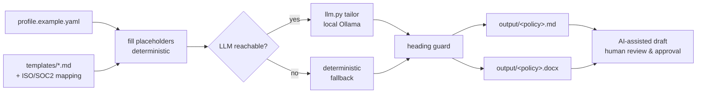

# policy-generator

Generate tailored, ISO 27001 / SOC 2-aligned information-security policies and SOPs from a short company profile, exported as clean Markdown and Word (.docx).

A real GRC deliverable: feed it who the company is and which policies you need, and it produces complete, control-mapped drafts your team can review and approve. It runs fully on a local LLM (Ollama) for tailoring, and still produces a complete policy if no model is available.

## The problem

Every company chasing ISO 27001 or SOC 2 needs the same core policy set, written in their own context: their cloud, their data types, their frameworks. Writing them from scratch is slow, and generic templates off the internet read like generic templates. The judgment (does this control fit us, do we accept this risk) has to stay human, but the first draft does not.

I spent ten years in IT operations and cloud security across an eight-company group. This is the "give me a solid first draft of the policy set" step automated, with the approval kept human and every output labelled as a draft that needs sign-off.

## What it does

1) Reads a company profile (`profile.example.yaml`): name, industry, size, cloud providers, data types, in-scope frameworks, owner and approver.
2) Loads base policy templates that carry placeholders, section skeletons, and an ISO 27001 / SOC 2 control mapping.
3) Fills every placeholder deterministically from the profile.
4) Calls a local LLM to tailor and expand the body to the company's context, and keeps a structural guard so a misbehaving model can never drop or rename sections. If the LLM is unreachable, it falls back to the complete deterministic draft.
5) Writes `output/<policy>.md` and `output/<policy>.docx`, each with a title, numbered sections, a document-control / approval table, and a footer stating it is an AI-assisted draft pending review.

## Architecture



## Install

```bash
# install as a command-line tool (recommended)
pipx install git+https://github.com/aminafara123/policy-generator
policy-generator --list
policy-generator --profile profile.example.yaml --out output
```

Or install into the current environment from a clone with `pip install .`. The `make` targets below still work for local development.

## Quickstart

```bash
# 1) install (python-docx, PyYAML, pytest)
make install

# 2) run the offline test gate (no network, no API key)
make test

# 3) generate the policies listed in profile.example.yaml
make run                 # tailors via local Ollama if present, else deterministic
# or, never contact an LLM:
make run-offline

# 4) see the Word + Markdown files
ls output/
```

Direct CLI:

```bash
python generate.py --list                                   # show available policies
python generate.py --profile profile.example.yaml --out output
python generate.py --profile profile.example.yaml --policies access-control,incident-response
python generate.py --profile profile.example.yaml --no-llm   # deterministic only
```

## Sample run

Input (excerpt of `profile.example.yaml`):

```yaml
company:
  name: "Northwind Health Labs"
  industry: "B2B SaaS / health-tech"
  cloud_providers: ["AWS (eu-west-1, eu-central-1)", "Cloudflare", "Google Workspace"]
  data_types: ["Customer PII", "Protected Health Information (PHI)", "Payment card data"]
  frameworks: ["ISO/IEC 27001:2022", "SOC 2 Type II"]
policies: [information-security-policy, access-control, data-classification, incident-response, vendor-risk]
```

Output:

```
  information-security-policy  -> information-security-policy.md, information-security-policy.docx  [LLM-tailored]
  access-control               -> access-control.md, access-control.docx  [LLM-tailored]
  data-classification          -> data-classification.md, data-classification.docx  [LLM-tailored]
  incident-response            -> incident-response.md, incident-response.docx  [LLM-tailored]
  vendor-risk                  -> vendor-risk.md, vendor-risk.docx  [LLM-tailored]

5 policy document(s) written to output/
All outputs are AI-assisted drafts — review and approve before use.
```

A committed example deliverable (generated deterministically, no LLM) lives in [`docs/sample-output/`](docs/sample-output/) so you can see the real thing without running anything.

## Control-area coverage

Each template notes its own mapping at the top. The full set covers these areas:

| Policy | ISO/IEC 27001:2022 Annex A | SOC 2 (Trust Services Criteria) |
|---|---|---|
| Information Security Policy | 5.1-5.4, 6.3 | CC1.1-CC1.5, CC2.2, CC5.3 |
| Access Control | 5.15-5.18, 8.2, 8.3, 8.5 | CC6.1-CC6.3 |
| Acceptable Use | 5.10, 6.3, 6.7, 8.1, 8.7 | CC1.1, CC2.2, CC6.7 |
| Data Classification & Handling | 5.12-5.14, 8.10-8.12 | CC6.1, CC6.5, C1.1-C1.2 |
| Incident Response | 5.24-5.28, 6.8 | CC7.3-CC7.5 |
| Business Continuity & DR | 5.29, 5.30, 8.13, 8.14 | A1.1-A1.3, CC7.5 |
| Vendor & Third-Party Risk | 5.19-5.23 | CC9.2 |
| Change Management | 8.31, 8.32, 8.9, 8.28 | CC8.1 |

## How it works

- `generate.py` is the whole engine: profile loading, placeholder substitution, selection logic, LLM tailoring with a heading-preservation guard, and a small Markdown-to-.docx renderer (headings, bullets, numbered lists, tables, bold).
- `llm.py` is one thin function over an OpenAI-compatible chat endpoint, configured only by environment variables (see `.env.example`). Stdlib only, so importing it pulls no network.
- Tailoring is a tightly-scoped enhancement, not a rewrite. The deterministic fill already produces a complete, sensible policy. The LLM makes it specific. If the model is down, returns nothing, or drops a heading, the tool uses the deterministic draft and says so.
- The approval table, AI-draft banner, and page footer are added in code, not sent to the model, so the audit-relevant structure is never at the mercy of model output.

## Honesty and safety

Every document is labelled an **AI-assisted draft** in its banner and page footer and marked "pending human review and approval". This is a drafting aid for a GRC team, not legal, audit, or compliance advice, and it does not claim or confer compliance. A qualified human must review, edit, and formally approve each policy before it takes effect. All sample data is fictional. No real company data and no credentials are included.

## Tech stack

Python 3, python-docx, PyYAML, pytest. LLM tailoring via any OpenAI-compatible endpoint (defaults to local Ollama, `qwen3:30b-a3b-instruct-2507-q4_K_M`). No external APIs, no keys committed.

## Demo


## License

MIT, Copyright (c) 2026 Al Amin Bashir Afara. See [LICENSE](LICENSE).

## About

Al Amin Bashir Afara, Dubai. [github.com/aminafara123](https://github.com/aminafara123) · [linkedin.com/in/aminafara](https://www.linkedin.com/in/aminafara)
